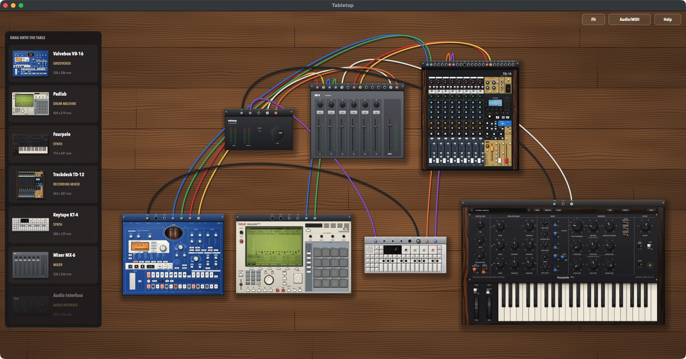
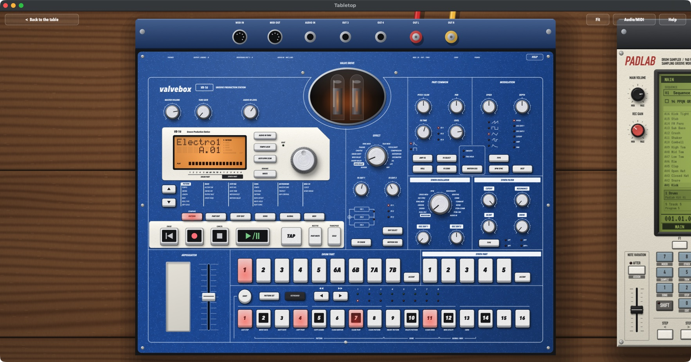

# Tabletop

A studio on a table. The research instruments sit on an endless wooden table at life size, and you cable them together the way you would in a real studio:
- [Fourpole](https://github.com/csprech/fourpole), a three-oscillator monosynth;
- [Valvebox](https://github.com/csprech/valvebox), a groovebox;
- [Padlab](https://github.com/csprech/padlab), a sampling drum machine;
- [Trackdesk](https://github.com/csprech/trackdesk), a 12-track recording console;
- [Keytape](https://github.com/csprech/keytape), a synthesizer around a 4-track tape;
- an audio interface and a mixer.

Zoom out to see the whole setup. Double-click a device and the view flies in, so you can play its real panel.

C++20 / JUCE 8, macOS (Apple Silicon tested). Each device lives in its own repository and is built into Tabletop from there. More devices will follow the same pattern.





## Build & run

### Requirements (macOS)

- **Xcode Command Line Tools**: `xcode-select --install`
- **CMake 3.22+ and Ninja**, e.g. `brew install cmake ninja`
- Access to the device repositories on GitHub (they're git submodules).

### Build

```sh
bash scripts/bootstrap.sh
cmake -S . -B build -G Ninja -DCMAKE_BUILD_TYPE=Release
cmake --build build
open build/Tabletop_artefacts/Release/Tabletop.app
```

- `bootstrap.sh` downloads JUCE 8.0.15 into `external/` and checks out the devices into `devices/`.
- To build against checkouts of the device repositories you're working on, add `-DTABLETOP_DEVICES_DIR=/path/to/folder-with-them`.

## Using it

### The table

- **Move around:** drag the wood. Two-finger scroll pans too.
- **Zoom:** pinch, or Cmd + scroll.
- **Fit** (or Cmd + 0): shows everything.

### Devices

- **The shelf:** down the left, each device is shown as a small picture of itself, with its name, what it is (synth, drum machine, mixer...) and its size.
- **Add one:** drag it from the shelf onto the table, or right-click the wood and choose "Put on the table". There's one audio interface; you can add as many of everything else as you like.
- **Move one:** drag it.
- **Remove one:** right-click it, then "Take off the table". Its cables come with it.
- **Play one:** double-click it and the view flies in to its real, live panel. Everything on it works as it does in the device's own app, including its computer-keyboard keys.
- **Step back:** "Back to the table", Cmd + Up, or double-click the wood.

### Cables

- **Connect:** every device has a strip of jacks along its back. Drag from a jack to a jack on another device.
- **Rules:** outputs go to inputs, and MIDI goes to MIDI. While you drag, the jacks the cable can go into light up.
- **Repatch or unplug:** drag a plug out of its jack and drop it on another jack, or on the table to unplug it.
- **Colours:** audio cables come in several colours; MIDI cables are black.

### The built-in gear

- **Audio interface:** your computer, on the table.
  - Cable to its **SPEAKERS** jacks to hear something. With only L cabled, both speakers play it.
  - **IN 1** and **IN 2** are your computer's audio inputs. macOS asks for permission the first time you cable them.
  - Its **MIDI** jack carries every MIDI controller you plug into the computer, now or later.
  - **Audio/MIDI** picks the computer's audio device.
- **Mixer MX-6:** six stereo channels, each with a fader, PAN and MUTE, plus the MAIN fader and meters. A channel with only its L jack cabled is mono.

### Trackdesk on the table

Trackdesk's back strip has its jacks in the original's order:
- **IN 1–6, 7/8 L/R and 9/10 L/R:** the channel inputs. An uncabled input is silent, and a stereo channel with only L cabled is mono.
- **MIDI OUT:** the console's MIDI clock and time code, to drive another sequencer (Valvebox follows it with its clock set to external).
- **CLICK, AUX 1, AUX 2, SUB L/R, MAIN L/R, PHONES 1/2 L/R:** its outputs. A cable in AUX 2 makes the built-in effect unavailable (FX.N/A), as on the original.
- **USB L/R:** what PC mode hears on channels 1–2.

Its faders start down, as the original's manual asks before switching on. Its songs are saved in the same card folder as the Trackdesk app's (`Music/Trackdesk Card`), and its panel settings are saved with the table.

### Keytape on the table

Keytape sits at its real size, 288 × 102 mm. Its edge has these jacks:
- **LINE IN L/R:** the mic/line input, which it samples, records and monitors. An uncabled input is silent, and with only L cabled it's mono.
- **USB IN L/R:** the second input pair (the USB audio source on its input screen).
- **USB MIDI IN:** notes, the original's CC map, program changes and clock. Set sync to MIDI to follow another device's clock.
- **USB MIDI OUT:** its clock (in beat match) and ctrl mode's notes.
- **OUT L/R:** its output. With sync out, the left channel carries the pulses.

Its tapes, mixdowns and snapshots are saved in the same folder as the Keytape app's (`Music/Keytape`). Its sounds, mixer and settings are saved with the table.

### Your tables

- **Saved automatically:** the table is saved when you quit (and every minute), and opens again next time. That includes every device's state: Fourpole's patch, Valvebox's whole memory, Padlab's project with its samples, Trackdesk's panel and settings, Keytape's sounds and settings, and the mixer's settings.
- **Copies:** **File > Save As** keeps a copy as a `.tabletop` file; **File > Open** brings one back.
- **New Table** sets up the first table again: everything cabled into the mixer and on to the speakers, with MIDI from your controllers going to Fourpole.

## How it works

- **The audio graph:** each device on the table is a node in one JUCE `AudioProcessorGraph`, and each cable is a connection in it, audio or MIDI. The audio interface's jacks are joined to the graph's links to the computer's audio device and MIDI inputs.
- **The devices:** each repository publishes a `<device>-module.cmake` listing its sources, and a processor wrapper in `src/plugin/`. The wrapper uses the same engine and panel as the device's own app, in a hosted mode that opens no audio device and takes its audio and MIDI from the graph. Tabletop compiles those sources into its own target.
- **Real size:** the table works in millimetres. Each device's panel is scaled to the device's real width, so they sit at their true sizes relative to each other.
- **Panel pictures:** zoomed out, the devices show pictures of their panels, refreshed a few times a second at a resolution that suits the zoom. That keeps panning and zooming smooth. The device you zoom in on gets its live panel.

| Folder | What's in it |
|---|---|
| `src/studio` | The device registry (sizes, jacks, how to make each), the session (graph, cables, saving), the audio interface and the mixer |
| `src/ui` | The table (camera, devices, jacks, cables, flying in), the wood, the window (shelf, menus, files) |
| `devices/` | The devices' repositories (git submodules) |

## Tests

The self-test runs the real app:

```sh
TRACKDESK_CARD_DIR=/tmp/card KEYTAPE_DIR=/tmp/keytape TABLETOP_SELFTEST=/tmp/report.txt ./build/Tabletop_artefacts/Release/Tabletop.app/Contents/MacOS/Tabletop
```

It checks:
- the shelf: every device has its transparent picture, name and kind;
- the first table's devices and cables;
- the cable rules (outputs to inputs, MIDI to MIDI, one cable per jack);
- mono detection on the mixer;
- each device's state round trip (Fourpole's patch, Valvebox's memory, Padlab's project and samples);
- Trackdesk on the table: its size and jacks, a cable in AUX 2 turning the effect off, its state round trip;
- Keytape on the table: its size and jacks, its outputs into the mixer, its state round trip;
- saving and opening a table;
- sound from the Valvebox through Trackdesk and the mixer to the speakers, and from Keytape's keyboard into the mixer;
- flying in to a live panel and back;
- removing a device along with its cables.

Other testing aids:
- `TABLETOP_NO_AUTOSAVE=1` leaves your saved table alone.
- `TABLETOP_OPEN=/path.tabletop` opens a table at launch.
- `TABLETOP_WINDOW_SIZE=WxH` forces a window size.
- `TABLETOP_RENDER_SHELF=assets/shelf` renders the shelf's pictures again from the devices' real panels, then quits. Do this after a device's look changes, and commit the PNG files. They're built into the app.

Each device's own tests live in its repository.
